# Historique Synthétique du Projet (`latex`)

> **Mécanisme actif :** Ce document résume l'évolution du dépôt en **3 horizons à compaction progressive** pour permettre à toute IA de comprendre le contexte en un minimum de tokens (~45–60 lignes max). Les phases anciennes sont condensées en une ligne ; la session courante est détaillée puis compactée lors des demandes suivantes.

```mermaid
flowchart LR
  P1["Phases 1-2<br/>Refonte .agents & AGENTS"] --> P3["Phase 3<br/>Skill markdown-to-latex"]
  P3 --> P4["Phase 4<br/>Déduplication .vscode"]
  P4 --> P56["Phases 5-6<br/>ClasseGuillaume & clean.ps1"]
  P56 --> P7["Phase 7<br/>Règle !CAUTION & Audits"]
  P7 --> P89["Phases 8-9<br/>FR/EN, .ignore & Slides v1"]
  P89 --> P10["Phase 10<br/>Slides v2.0 & Règle Plan/Hist"]
  P10 --> P11["Phase 11<br/>portefolio_2 & Rétroportage"]
  P11 --> P12["Phase 12<br/>Refonte Styles & Biblio"]
  P12 --> P13["Phase 13<br/>Tableaux Paysages & Annexe A"]
  P13 --> P14["Phase 14<br/>Paragraphes & Listes KOMA"]
  P14 --> P15["Phase 15<br/>Annexe A ↔, Liens & cp/j"]
```

---

## 1. Socle Ancien *(compacté)*
- **Phases 1–7 :** Refonte `.agents/` & `AGENTS.md`, `sync-mcp.ps1`, skill `markdown-to-latex`, alignement `.vscode/`, `ClasseGuillaume.cls`, `clean.ps1`, règle `> [!CAUTION]`.
- **Phases 8–12 :** Options `french`/`english`, `.chktexrc-en`, gouvernance `docs/plan.md` + `docs/historique.md`, `ClasseGuillaumeSlides v2.0`, création modulaire de [`portefolio_2`](../projets/portefolio_2/README.md) (palette des couvertures, `spacing=double`, `siunitx`, biblio Vancouver, notes `GuillaumeVertStyle`, `\let\textsc\@firstofone`).

---

## 2. Évolution Récente *(synthétique)*
- **Phase 13 — Tableaux paysages & ancrage direct d'Annexe A ([tableaux](../projets/portefolio_2/docs/harmonisation-tableaux-paysages.md)) :** orientation `pdflscape`, double filet `\hhline`, notes `ThreePartTable`, ajout de `radioPatient.jpeg` avec ancres directes `\phantomsection\label`.
- **Phase 14 — Paragraphes, règles Git, `needspace` & listes `compact` ([Q&R §10–12](../projets/portefolio_2/docs/questions-typographie-et-latex.md#L169)) :** remplacement des `\\` par lignes vides, suppression de `\listofillustrations`, interdiction des guillemets en commit Git, `needspace` automatique (`template_officiel` + `portefolio_2`), et différenciation `[compact]` vs `doublespacing` dans `portefolio_2` uniquement.

---

## 3. Session Courante *(détaillée — sera compactée au prochain changement majeur)*
- **Phase 15 — Liens bidirectionnels Annexe A, palette hyperliens, `cp/j` & `\subsectionformat` ([Q&R §13–14](../projets/portefolio_2/docs/questions-typographie-et-latex.md#L258)) :**
  - **Ancrage exact des 4 pages d'Annexe A :** renvoi de la p. 50 ([`01-rapport-synthetique.tex`](../projets/portefolio_2/content/05-cas-polypathologique-complexe/01-rapport-synthetique.tex#L98)) redirigé sur la p. 2 de `ExamenParacliniqueCasM2.pdf` (`annexe:examens_cas_v`, p. 62) ; ancres de retour `\leavevmode\phantomsection\label` ajoutées en p. 24 (`retour:examens_cas_iii`), p. 50 (`retour:examens_cas_v`) et p. 59 (`retour:radio_patient`), affichées en pied de page via `\setAnnexBackLink` / `\clearAnnexBackLink` dans [`appendix-a.tex`](../projets/portefolio_2/backmatter/appendix-a.tex) et [`portefolio-style.sty`](../projets/portefolio_2/config/portefolio-style.sty#L82-L108) (avec `scale=0.93, offset=0 0.35cm`, note `\todoH[GuillaumeVertStyle]` et commentaire `%` en p. 64).
  - **Hyperliens & garde-fous :** activation en mode `screen` d'une palette sobre (`PortfolioLink`, `PortfolioCite`, `PortfolioUrl`) tout en conservant `hidelinks` en mode `print`, avec protection `linkcolor=.` des listes (`\tableofcontents`, `\listoffigures`, `\listoftables`, `\listoftodos`) et du texte surligné `\todoH` dans [`portefolio_2/config/macros.sty`](../projets/portefolio_2/config/macros.sty#L397) et [`template_officiel/config/macros.sty`](../templates/template_officiel/config/macros.sty#L397).
  - **Typographie clinique :** note de bas de page explicative pour `cp/j` en p. 24 ([`01-cas-clinique.tex`](../projets/portefolio_2/content/03-cas-therapeutique/01-cas-clinique.tex#L66)) et héritage direct de `CoverPlum` sur les numéros `\subsectionformat` ([`portefolio-style.sty`](../projets/portefolio_2/config/portefolio-style.sty#L189)).
  - **Validation :** `portefolio_2` (`73` p., `0` erreur, `0` `Overfull`/`Underfull`, `2` `Marginpar` p. 16/18, `chktex` à `0` sur `portefolio-style.sty` et `appendix-a.tex`) et `template_officiel` (`56` p., `0` erreur) vérifiés avec contrôle visuel PNG.
