# Historique Synthétique du Projet (`general`)

> **Mécanisme actif :** Ce document résume l'évolution du dépôt en **3 horizons à compaction progressive** pour permettre à toute IA de comprendre le contexte en un minimum de tokens (~45–60 lignes max). Les phases anciennes sont condensées en une ligne ; la session courante est détaillée puis compactée lors des demandes suivantes.

```mermaid
flowchart LR
  P1["Phases 1-2<br/>Refonte .agents & AGENTS"] --> P3["Phase 3<br/>Skill markdown-to-latex"]
  P3 --> P4["Phase 4<br/>Déduplication .vscode"]
  P4 --> P56["Phases 5-6<br/>ClasseGuillaume & clean.ps1"]
  P56 --> P7["Phase 7<br/>Règle !CAUTION & Audits"]
  P7 --> P89["Phases 8-9<br/>FR/EN, .ignore & Slides v1"]
  P89 --> P10["Phase 10<br/>Slides v2.0 & Règle Plan/Hist"]
  P10 --> P11["Phase 11<br/>portefolio_2 & Rétroportage"]
  P11 --> P12["Phase 12<br/>Refonte Styles & Biblio"]
  P12 --> P13["Phase 13<br/>Tableaux Paysages & Annexe A"]
  P13 --> P14["Phase 14<br/>Paragraphes & Listes KOMA"]
```

---

## 1. Socle Ancien *(compacté)*
- **Phases 1–7 :** Refonte `.agents/` & `AGENTS.md`, `sync-mcp.ps1`, skill `markdown-to-latex`, alignement `.vscode/`, `ClasseGuillaume.cls`, `clean.ps1`, règle `> [!CAUTION]`.
- **Phases 8–11 :** Options `french`/`english`, `.chktexrc-en`, gouvernance `docs/plan.md` + `docs/historique.md`, `ClasseGuillaumeSlides v2.0` et création modulaire de [`portefolio_2`](file:///c:/Users/guill/dev/perso/latex/general/projets/portefolio_2/README.md) (`ClasseGuillaume v2.0`, parité rédactionnelle, rétroportages).

---

## 2. Évolution Récente *(synthétique)*
- **Phase 12 — Refonte éditoriale, Vancouver & typographie `portefolio_2` ([refonte](file:///c:/Users/guill/dev/perso/latex/general/projets/portefolio_2/docs/refonte-styles-et-bibliographie.md), [Q&R](file:///c:/Users/guill/dev/perso/latex/general/projets/portefolio_2/docs/questions-typographie-et-latex.md)) :** palette des couvertures, `spacing=double` + listes `\singlespacing`, `siunitx` (`mode = text`), biblio Vancouver, notes vertes `GuillaumeVertStyle` et `\let\textsc\@firstofone` rétroporté.
- **Phase 13 — Tableaux paysages & ancrage direct d'Annexe A ([tableaux](file:///c:/Users/guill/dev/perso/latex/general/projets/portefolio_2/docs/harmonisation-tableaux-paysages.md), [`appendix-a.tex`](file:///c:/Users/guill/dev/perso/latex/general/projets/portefolio_2/backmatter/appendix-a.tex)) :** orientation unifiée `pdflscape`, double filet `\hhline`, notes `ThreePartTable` (`cp`/`inh`), ajout de `radioPatient.jpeg` après `ExamenParacliniqueCasM2.pdf` avec ancres `\phantomsection\label` distinctes et renvoi temporaire `\todoH[GuillaumeVertStyle]`.

---

## 3. Session Courante *(détaillée — sera compactée au prochain changement majeur)*
- **Phase 14 — Nettoyage `\\`/paragraphes, guillemets, listes KOMA-Script & règle Git ([Q&R §10–11](file:///c:/Users/guill/dev/perso/latex/general/projets/portefolio_2/docs/questions-typographie-et-latex.md)) :**
  - Remplacement des `\\` séparateurs de paragraphes par des lignes vides ([`01-auto-evaluation.tex`](file:///c:/Users/guill/dev/perso/latex/general/projets/portefolio_2/content/06-auto-evaluation/01-auto-evaluation.tex), [`02-impact-personnel.tex`](file:///c:/Users/guill/dev/perso/latex/general/projets/portefolio_2/content/02-activite-exterieure/02-impact-personnel.tex#L5), [`02-approche-reflexive.tex`](file:///c:/Users/guill/dev/perso/latex/general/projets/portefolio_2/content/05-cas-polypathologique-complexe/02-approche-reflexive.tex#L5)) pour restaurer `parskip=half`, suppression du `\\` devant `\section` et `"mœurs"` $\rightarrow$ `« mœurs »`.
  - Retrait de `\listofillustrations` (page blanche sans `\begin{illustration}`) dans [`portefolio_2/main.tex`](file:///c:/Users/guill/dev/perso/latex/general/projets/portefolio_2/main.tex#L65-L69) tout en conservant `\listoffigures` natif `tocbasic`, aligné sur [`template_officiel/main.tex`](file:///c:/Users/guill/dev/perso/latex/general/templates/template_officiel/main.tex#L56-L59).
  - Mise à jour de la règle globale Git ([`AGENTS.md`](file:///C:/Users/guill/.agents/AGENTS.md) & [`01-git-et-planification.md`](file:///C:/Users/guill/.agents/rules/01-git-et-planification.md), synchronisés via `deploy-and-sync-global.ps1`) interdisant tout guillemet dans les messages de commit, et implémentation automatique `needspace` (`\AddToHook` sur `\section`/`\subsection`) dans [`template_officiel`](file:///c:/Users/guill/dev/perso/latex/general/templates/template_officiel/config/packages.sty#L233-L249) (`8\baselineskip` / `5\baselineskip`) et [`portefolio_2`](file:///c:/Users/guill/dev/perso/latex/general/projets/portefolio_2/config/portefolio-style.sty#L31-L32) (`12\baselineskip`, § 11).
  - Différenciation des listes à puces de `portefolio_2` sans rétroportage sur `template_officiel` ([Q&R § 12](file:///c:/Users/guill/dev/perso/latex/general/projets/portefolio_2/docs/questions-typographie-et-latex.md#L214)) : retour au `doublespacing` normal par défaut (`parsep=0.45em`) pour les `13` listes longues et clé `enumitem` `compact` (`before=\setstretch{1}`) appliquée aux `15` listes courtes (`[compact, label=\textbullet]`).
  - **Validation :** `portefolio_2` (`73` p., `0` erreur, `0` `Overfull`, `0` `Underfull`, `2` `Marginpar` p. 16/18 ; `chktex` à `0` sur `portefolio-style.sty`) et `template_officiel` (`56` p., `0` erreur, `0` `Overfull` en `appendix-a.tex`), parité `packages.sty` confirmée.
