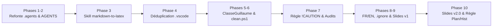

# Historique Synthétique du Projet (`general`)

> **Mécanisme actif :** Ce document résume l'évolution du dépôt en **3 horizons à compaction progressive** pour permettre à toute IA de comprendre le contexte en un minimum de tokens (~45–60 lignes max). Les phases anciennes sont condensées en une ligne ; la session courante est détaillée puis compactée lors des demandes suivantes.

---

## 1. Socle Ancien *(compacté)*
- **Phases 1–2 :** Refonte de `AGENTS.md` et `.agents/` (suppression du MCP `memory` et modèles obsolètes), script `sync-mcp.ps1` corrigé en UTF-8 sans BOM.
- **Phases 3–4 :** Création du skill `markdown-to-latex`, workflows associés, et déduplication/alignement de `.vscode/` sur la configuration globale.
- **Phases 5–6 :** Renommage de la classe en `ClasseGuillaume.cls`, sécurisation de `clean.ps1` (préservation du PDF et des logs) et assouplissement des citations.
- **Phase 7 :** Ajout de la règle globale de proposition visible (`> [!CAUTION]`) et audits linguistique / extensions / `.ignore`.

---

## 2. Évolution Récente *(synthétique)*
- **Phase 8 — Support bilingue FR/EN & `.ignore` :** option `french`/`english` dans `ClasseGuillaume`, `.chktexrc-en`, option `-Language` dans `lint-latex.ps1` et accès conservé aux `*.pdf`/`*.log`/`*.bbl`/`*.blg`.
- **Phase 9 — Exclusions globales & `ClasseGuillaumeSlides v1` :** transfert des exclusions génériques vers les réglages globaux, création de `templates/template_slides/` et `<projet>/slides/` (`integrated`), et premier prototype `plan.md` / `historique.md`.

---

## 3. Session Courante *(détaillée — sera compactée au prochain changement majeur)*
- **Phase 10 — Règle globale validée, archivage visuel & refonte `ClasseGuillaumeSlides v2.0` :**
  - **Gouvernance globale :** Règle 2 (`docs/plan.md` éphémère + `docs/historique.md` à compaction progressive) inscrite dans `C:\Users\guill\.agents\` et synchronisée via `deploy-and-sync-global.ps1`.
  - **Références visuelles :** 23 planches d'exemple inspectées et archivées dans [`templates/exemples-slides/`](file:///c:/Users/guill/dev/perso/latex/general/templates/exemples-slides) (exclu de Git via `.gitignore` sans ignorer `*.png` ; `exemple/` supprimé).
  - **Refonte `ClasseGuillaumeSlides v2.0` :** 4 palettes (`navy`, `forest`, `sage`, `vibrant`) clair/sombre, 3 styles (`editorial`, `organic`, `minimal`), 4 couvertures (`diagonal`, `organic`, `framed`, `editorial`), composants ouverts sans boîtes lourdes (`\minimalstat`, `railpoints`, `processline`, `timelineflow`, `funnelchart`, `cyclechart`, `\floatingcard`, `\tiltframe`, `\usebandcanvas`, `\userailcanvas`, `ClasseGuillaumeAxis`), canevas indépendant de `remember picture` et correction de l'espacement `frametitle`.
  - **Documentation & Veille MCP :** mise à jour du skill `latex-slides`, `README.md`, `appendix-a.tex`, et rédaction de [`docs/compte-rendu-et-reponses.md`](file:///c:/Users/guill/dev/perso/latex/general/docs/compte-rendu-et-reponses.md) (analyse Marketplace/GitHub sur les MCP de présentation).
  - **Validation :** compilation à froid LuaLaTeX + `ChkTeX` sans erreur (`0` erreur, `0` avert., `0` Overfull) et contrôle visuel PNG sur `template_slides` (18 p.), `template_officiel/slides` (9 p.) et un test `english + theme=dark + vibrant + organic` (7 p.), plus non-régression `template_officiel` (56 p.).
