# Historique Synthétique du Projet (`latex`)

> **Mécanisme actif :** Ce document résume l'évolution du dépôt en **3 horizons à compaction progressive** pour permettre à toute IA de comprendre le contexte en un minimum de tokens (~45–60 lignes max). Les phases anciennes sont condensées en une ligne ; la session courante est détaillée puis compactée lors des demandes suivantes.

```mermaid
flowchart LR
  P1["Phases 1-2<br/>Refonte .agents & AGENTS"] --> P3["Phase 3<br/>Skill markdown-to-latex"]
  P3 --> P4["Phase 4<br/>Déduplication .vscode"]
  P4 --> P56["Phases 5-6<br/>ClasseGuillaume & clean.ps1"]
  P56 --> P7["Phase 7<br/>Règle !CAUTION & Audits"]
  P7 --> P89["Phases 8-9<br/>FR/EN, .ignore & Slides v1"]
  P89 --> P10["Phase 10<br/>Slides v2.0 & Règle Plan/Hist"]
  P10 --> P11["Phase 11<br/>portfolio & Rétroportage"]
  P11 --> P12["Phase 12<br/>Refonte Styles & Biblio"]
  P12 --> P13["Phase 13<br/>Tableaux Paysages & Annexe A"]
  P13 --> P14["Phase 14<br/>Paragraphes & Listes KOMA"]
  P14 --> P15["Phase 15<br/>Annexe A ↔, Liens & cp/j"]
  P15 --> P16["Phase 16<br/>Racine, portfolio & MCP"]
```

---

## 1. Socle Ancien *(compacté)*
- **Phases 1–7 :** Refonte `.agents/` & `AGENTS.md`, `sync-mcp.ps1`, skill `markdown-to-latex`, alignement `.vscode/`, `ClasseGuillaume.cls`, `clean.ps1`, règle `> [!CAUTION]`.
- **Phases 8–13 :** Options `french`/`english`, `.chktexrc-en`, gouvernance `docs/plan.md` + `docs/historique.md`, `ClasseGuillaumeSlides v2.0`, création de [`portfolio`](../projets/portfolio/README.md) (couvertures, `siunitx`, biblio Vancouver, `GuillaumeVertStyle`, tableaux paysages `pdflscape`/`ThreePartTable`, `radioPatient.jpeg`).

---

## 2. Évolution Récente *(synthétique)*
- **Phase 14 — Paragraphes, règles Git, `needspace` & listes `compact` ([Q&R §10–12](../projets/portfolio/docs/questions-typographie-et-latex.md#L169)) :** suppression de `\listofillustrations`, interdiction des guillemets en commit, `needspace` auto, `[compact]` vs `doublespacing` dans `portfolio`.
- **Phase 15 — Liens bidirectionnels Annexe A, palette hyperliens & `cp/j` ([Q&R §13–14](../projets/portfolio/docs/questions-typographie-et-latex.md#L258)) :** ancres aller-retour sur 4 pages d'annexes (`\setAnnexBackLink`), palette `PortfolioLink`/`PortfolioCite`/`PortfolioUrl` en mode `screen` (`linkcolor=.` sur tables), note `cp/j` et `\subsectionformat` `CoverPlum` (`73` p., `0` erreur).

---

## 3. Session Courante *(détaillée — sera compactée au prochain changement majeur)*
- **Phase 16 — Migration racine `latex/`, renommage `portfolio` & harmonisation MCP ([compte-rendu §4](compte-rendu-et-reponses.md#L56)) :**
  - **Migration & `portfolio` :** bascule vers `c:\Users\guill\dev\perso\latex`, correction de `audit-bib.ps1` (`biblio/references.bib`), renommage `projets/portefolio_2` $\rightarrow$ `projets/portfolio` (recompilation `73` p., `0` erreur).
  - **Nettoyage MCP local LaTeX :** suppression de `latex-compiler` (amont cassé) et `latex-workshop-assistant` (cible `pdflatex`/`xelatex`, redondant avec `compile.ps1`/`lint-latex.ps1`) de [`.agents/mcp_config.json`](../.agents/mcp_config.json) et [`.agents/subagents/compiler-debugger.md`](../.agents/subagents/compiler-debugger.md) ; maintien local strict de `arxiv-latex` et `zotero-citations` via [`sync-mcp.ps1`](../.agents/scripts/sync-mcp.ps1).
  - **Harmonisation MCP globale :** déplacement des serveurs généralistes `io.draw/mcp` et `brave-search` vers `C:\Users\guill\.agents\mcp_config.json` (0 MCP LaTeX) et création de `C:\Users\guill\.agents\scripts\sync-mcp-global.ps1` (branché dans `deploy-and-sync-global.ps1`) pour aligner Antigravity, Gemini, Claude, Cline et VS Code.
