# Historique Synthétique du Projet (`general`)

> **Mécanisme actif :** Ce document résume l'évolution du dépôt en **3 horizons à compaction progressive** pour permettre à toute IA de comprendre le contexte en un minimum de tokens (~45–60 lignes max). Les phases anciennes sont condensées en une ligne ; la session courante est détaillée puis compactée lors des demandes suivantes.

```mermaid
flowchart LR
  P1["Phases 1-2<br/>Refonte .agents & AGENTS"] --> P3["Phase 3<br/>Skill markdown-to-latex"]
  P3 --> P4["Phase 4<br/>Déduplication .vscode"]
  P4 --> P56["Phases 5-6<br/>ClasseGuillaume & clean.ps1"]
  P56 --> P7["Phase 7<br/>Règle !CAUTION & Audits"]
  P7 --> P89["Phases 8-9<br/>FR/EN, .ignore & Slides v1"]
  P89 --> P10["Phase 10<br/>Slides v2.0 & Règle Plan/Hist"]
  P10 --> P11["Phase 11<br/>portefolio_2 & Rétroportage"]
  P11 --> P12["Phase 12<br/>Refonte Styles & Biblio portefolio_2"]
```

---

## 1. Socle Ancien *(compacté)*
- **Phases 1–4 :** Refonte `.agents/` & `AGENTS.md`, `sync-mcp.ps1`, skill `markdown-to-latex` et alignement `.vscode/`.
- **Phases 5–7 :** Renommage `ClasseGuillaume.cls`, `clean.ps1`, citation libre, règle `> [!CAUTION]` et audits FR/`.ignore`.
- **Phase 8–9 :** Option `french`/`english`, `.chktexrc-en`, exclusions globales et création de `ClasseGuillaumeSlides v1`.

---

## 2. Évolution Récente *(synthétique)*
- **Phase 10 — Gouvernance Plan/Hist & `ClasseGuillaumeSlides v2.0` :** règle globale `docs/plan.md` éphémère + `docs/historique.md` compact, archivage [`templates/exemples-slides/`](file:///c:/Users/guill/dev/perso/latex/general/templates/exemples-slides) et refonte 4 palettes / 3 styles de `ClasseGuillaumeSlides v2.0`.
- **Phase 11 — Création modulaire de [`projets/portefolio_2/`](file:///c:/Users/guill/dev/perso/latex/general/projets/portefolio_2/README.md) & rétroportage :** migration de `portefolio_1` vers `ClasseGuillaume v2.0` (`font=comicsans`, `bibstyle=custom|vancouver`, `spacing=*`, `lua-ul`, `\todoH` sécurisé) avec parité rédactionnelle stricte et diagnostic `build/` ([`diagnostic-avertissements-compilation.md`](file:///c:/Users/guill/dev/perso/latex/general/projets/portefolio_2/docs/diagnostic-avertissements-compilation.md)).

---

## 3. Session Courante *(détaillée — sera compactée au prochain changement majeur)*
- **Phase 12 — Refonte éditoriale, bibliographie Vancouver & typographie de [`projets/portefolio_2/`](file:///c:/Users/guill/dev/perso/latex/general/projets/portefolio_2/README.md) ([refonte](file:///c:/Users/guill/dev/perso/latex/general/projets/portefolio_2/docs/refonte-styles-et-bibliographie.md), [Q&R techniques](file:///c:/Users/guill/dev/perso/latex/general/projets/portefolio_2/docs/questions-typographie-et-latex.md)) :**
  - **Charte des pages de garde, interligne & listes ([`portefolio-style.sty`](file:///c:/Users/guill/dev/perso/latex/general/projets/portefolio_2/config/portefolio-style.sty)) :** palette `CoverNavy`/`CoverPlum`/`CoverSky`/`CoverSlate`, retour à `spacing=double` dans `main.tex` avec listes `\singlespacing`, chapitres à barre tricolore, en-têtes/pieds de page folio badge, `\DeclareSIUnit\dL` + `sisetup` (`mode = text`) et notes vertes `GuillaumeVertStyle` (`siep_formation_524`, `lagedamon2025accompagnement`).
  - **Unités `siunitx`, bibliographie Vancouver & rétroportage `template_officiel` :** nettoyage des `$...$` superflus et passage aux macros `siunitx` dans 10 fichiers sans altérer un mot de prose ; suppression des `custom-style.{bbx,cbx}`, mois FR (EN conservés sous `[english]`), nettoyage UTF-8/BibLaTeX de [`references.bib`](file:///c:/Users/guill/dev/perso/latex/general/projets/portefolio_2/biblio/references.bib) et `\let\textsc\@firstofone` rétroporté.
  - **Validation :** compilation (`68` p., `0` erreur, `0` `Overfull \hbox`, `2` avertissements `Marginpar` p. 16/18, `18` citekeys Biber), `0` avertissement ChkTeX sur style/config, contrôles visuels PNG et parité stricte des mots.
