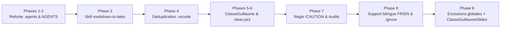

# Historique Synthétique du Projet (`general`)

> **Mécanisme (test en cours) :** Ce document résume l'évolution du dépôt en **3 horizons à compaction progressive** pour permettre à toute IA de comprendre le contexte en un clin d'œil avec un minimum de tokens (~50–70 lignes max). Les phases anciennes sont condensées en une ligne ; la session courante est détaillée puis compactée lors des demandes suivantes.

---

## 1. Socle Ancien *(compacté)*
- **Phases 1–2 :** Refonte complète de `AGENTS.md` et `.agents/` (rules, skills, sous-agents, suppression du MCP `memory` et des modèles obsolètes), script `sync-mcp.ps1` corrigé en UTF-8 sans BOM.
- **Phase 3 :** Création du skill `markdown-to-latex` (+ table de mapping) et des workflows `new-project`, `markdown-to-latex`, `build-and-verify` (+ prompt `.github/prompts/`).
- **Phase 4 :** Déduplication et alignement de `.vscode/` (`settings.json`, `extensions.json`, `tasks.json`) avec la configuration globale.
- **Phases 5–6 :** Renommage de la classe officielle en `ClasseGuillaume.cls`, sécurisation de `clean.ps1` / `latexmkrc` (préservation du PDF et des logs de debug), assouplissement des règles de citations et validation LuaLaTeX complète.
- **Phase 7 :** Ajout de la règle globale de proposition visible (`> [!CAUTION]`) dans `C:\Users\guill\.agents\`, audits linguistique/extensions/ignore et consolidation dans `docs/compte-rendu-et-reponses.md`.

---

## 2. Évolution Récente *(synthétique)*
- **Phase 8 — Support bilingue & Hygiène `.ignore` :**
  - Implémentation de l'option de classe `french` (défaut) / `english` dans `templates/template_officiel/` (`ClasseGuillaume.cls`, `packages.sty`, `macros.sty`, `.chktexrc-en`, détection `-Language` dans `lint-latex.ps1`).
  - Complétion des fichiers `.aiexclude`, `.claudeignore`, `.geminiignore` (auxiliaires jetables exclus, tout en gardant `*.pdf`, `*.log`, `*.blg`, `*.bbl` accessibles pour l'inspection visuelle et le diagnostic).

---

## 3. Session Courante *(détaillée — sera compactée au prochain changement majeur)*
- **Phase 9 — Exclusions globales, `ClasseGuillaumeSlides` & Prototype `historique.md` :**
  - **Exclusions IA globales :** secrets et bruits OS/Python déplacés vers `C:\Users\guill\.claude\settings.json`, `C:\Users\guill\.gitignore_global` et `settings.cleaned.json` (`search.exclude`) ; `.aiexclude`/`.geminiignore`/`.claudeignore` locaux conservés pour secrets/venv Antigravity/Gemini et auxiliaires LaTeX jetables (avec `*.pdf`, `*.log`, `*.blg`, `*.bbl` autorisés).
  - **Socle slides modernes (`ClasseGuillaumeSlides`) :** création de [`templates/template_slides/`](file:///c:/Users/guill/dev/perso/latex/general/templates/template_slides/README.md) (autonome 16:9 éditorial `light`/`dark`, `french`/`english`, `moloch` + `tcolorbox`) et du sous-projet lié [`templates/template_officiel/slides/`](file:///c:/Users/guill/dev/perso/latex/general/templates/template_officiel/slides/main.tex) (`integrated` + `\slideasset{}` + `TEXINPUTS` isolé).
  - **Outillage IA & Scripts :** création du skill [`latex-slides`](file:///c:/Users/guill/dev/perso/latex/general/.agents/skills/latex-slides/SKILL.md) (guides `design-patterns.md` et `document-to-slides-guide.md`), workflows `new-slides.md` / `latex-to-slides.md`, prompt `.github/prompts/latex-to-slides.prompt.md`, mise à jour `AGENTS.md`, `rules/`, `subagents/`, `clean.ps1` et `lint-latex.ps1`.
  - **Prototype documentaire :** test local du couple `plan.md` éphémère + `historique.md` à compaction progressive (sans modification globale avant accord utilisateur).
  - **Validation :** compilation à froid `LuaLaTeX` + `ChkTeX` sans erreur sur `template_slides` (15 p., 0 avert., 0 ChkTeX), `template_officiel/slides` (8 p., 0 avert., 0 ChkTeX), variante test `english` + `theme=dark` (5 p., 0 avert., 0 ChkTeX), et non-régression `template_officiel` principal (56 p., 0 erreur fatale).
